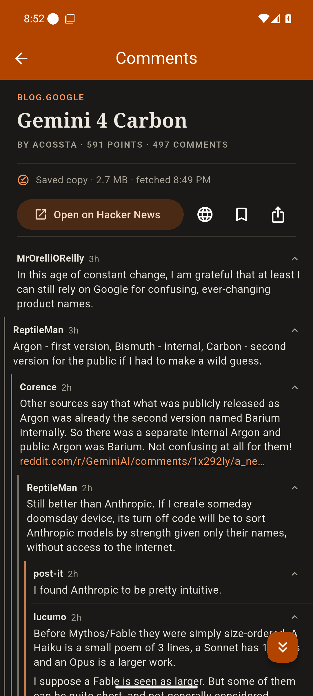
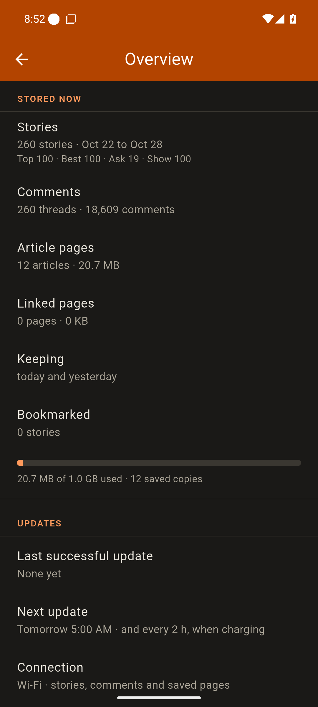
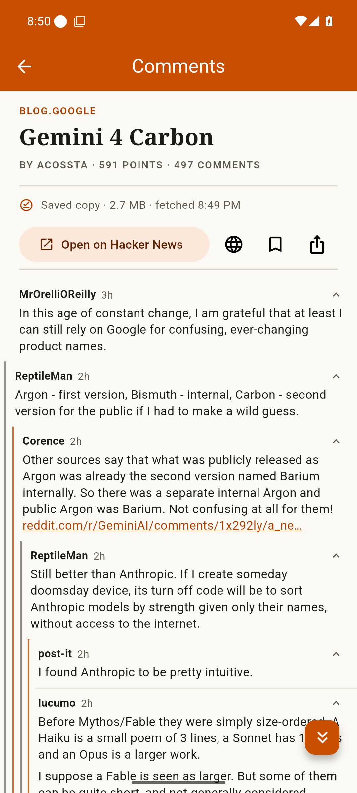
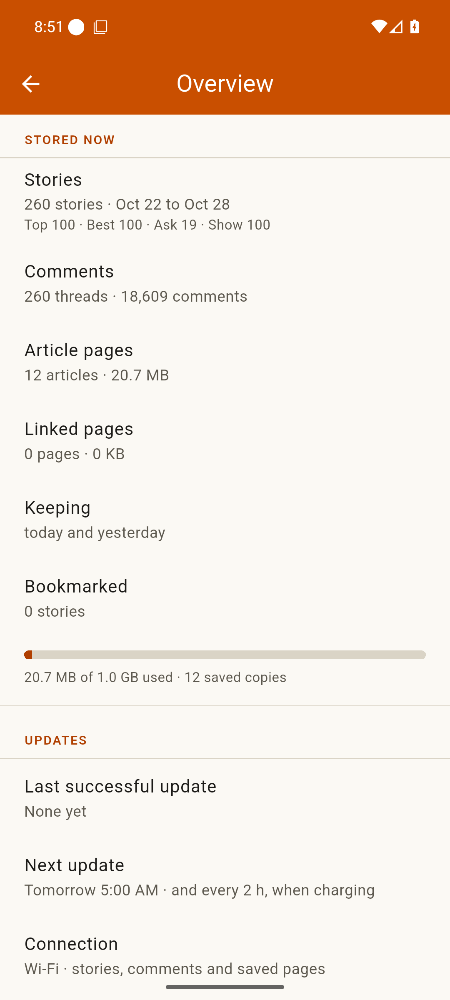

# Offline HN
Offline HN is an unofficial [Hacker News](https://news.ycombinator.com) reader for Android that downloads stories, comments and linked articles on Wi-Fi, so you can read them offline.

### Features
- Top, Best, Ask and Show feeds with search
- Collapsible comment threads, sorted like on HN, oldest or newest first
- Saved copies of linked articles (and links from top comments), with ads and cookie banners removed
- Background updates, by default only on Wi-Fi and while charging
- Swipe between feeds and stories, hide read stories
- Overview of each update and storage usage

### Screenshots (dark/light mode)
|                  Feed                   |                    Comments                     |                    Overview                     |
| :-------------------------------------: | :---------------------------------------------: | :---------------------------------------------: |
|  |  |  |

|                  Feed                   |                    Comments                     |                    Overview                     |
| :-------------------------------------: | :---------------------------------------------: | :---------------------------------------------: |
|  |  |  |

### Warning about LLM-generated code

This app is significantly vibe-coded / created using LLMs. Most of its code has not been thoroughly reviewed by a human.

### Installation & updates
If you have [F-Droid](https://f-droid.org/) installed, you can add [my repository](https://github.com/xarantolus/fdroid). Make sure you have "Include anti-feature apps" enabled in settings. Then search for "Offline HN" in the F-Droid client to download it. You will receive update notifications.

To add my repo, copy the following [link](https://raw.githubusercontent.com/xarantolus/fdroid/main/fdroid/repo?fingerprint=080898ae4309aeceb58915e43a4b7c4a3e2cda40c91738e2c02f58339ab2fbd7), then add this repository to your F-Droid client:

```
https://raw.githubusercontent.com/xarantolus/fdroid/main/fdroid/repo?fingerprint=080898ae4309aeceb58915e43a4b7c4a3e2cda40c91738e2c02f58339ab2fbd7
```

Alternatively, you can also scan this QR code:

<p align="center">
	
</p>

Alternatively, you can [download the APK file](https://github.com/xarantolus/offline-hn/releases/latest/download/app-release.apk) and install the app manually. You will not receive update notifications this way, but you can watch this repository to get notified of new releases.

### Where the data comes from
- **Stories and comments:** the official [Hacker News API](https://github.com/HackerNews/API) and [HN Search by Algolia](https://hn.algolia.com/api). The app doesn't scrape news.ycombinator.com.
- **Linked articles:** loaded in a hidden WebView and saved as MHTML files.
- **Filter lists:** downloaded from their maintainers and updated weekly, configurable in the settings.

### Development
Offline HN is a Flutter app. Ad blocking uses Brave's [adblock-rust](https://github.com/brave/adblock-rust), which Gradle builds for Android. Install the Rust toolchain once (needs a C compiler and the Android NDK):

```sh
tool/setup-rust.sh
```

Then:

```sh
git clone https://github.com/xarantolus/offline-hn.git
cd offline-hn
flutter pub get
flutter build apk --debug    # or: flutter run
```

Or work in the dev container, which has Flutter, the Android SDK and NDK, Rust with `cargo-ndk`, a headless emulator (`.devcontainer/emulator.sh`) and Claude Code, at pinned versions. It needs podman, and the emulator needs your user in the `kvm` group:

```sh
./run-container.sh
```

Generated code is committed; regenerate it after changing models or the database with `dart run build_runner build`. Rust tests: `cargo test --locked` in `packages/page_capture/rust`.

Vendored code is updated by scripts in `tool/` (`update-autoconsent`, `update-procedural-filters`, `update-rust-notice`).

Release builds are signed using `android/key.properties` or the `X_KEYSTORE_PATH` environment variable.

### Limitations
- Read-only: no login, voting or commenting
- Pages behind logins or captchas can't be saved, video links are skipped
- Content that pages load later via JavaScript is missing

### License
Offline HN is licensed under the [MIT License](LICENSE). It uses [adblock-rust](https://github.com/brave/adblock-rust), code from [brave-core](https://github.com/brave/brave-core) and [@duckduckgo/autoconsent](https://github.com/duckduckgo/autoconsent), all MPL-2.0. All licences are listed in the app under Settings → Open source licences.

Offline HN is not affiliated with or endorsed by Y Combinator.
